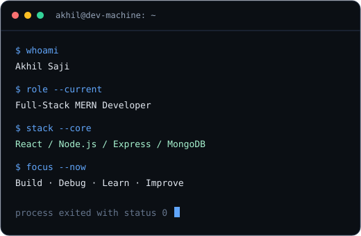
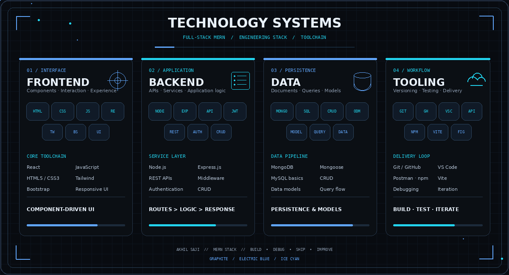
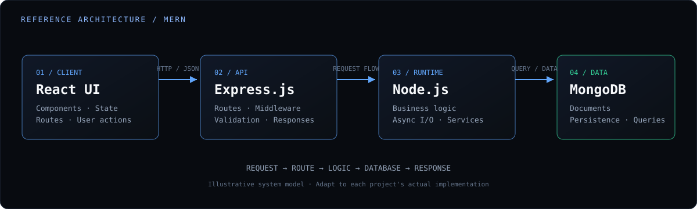
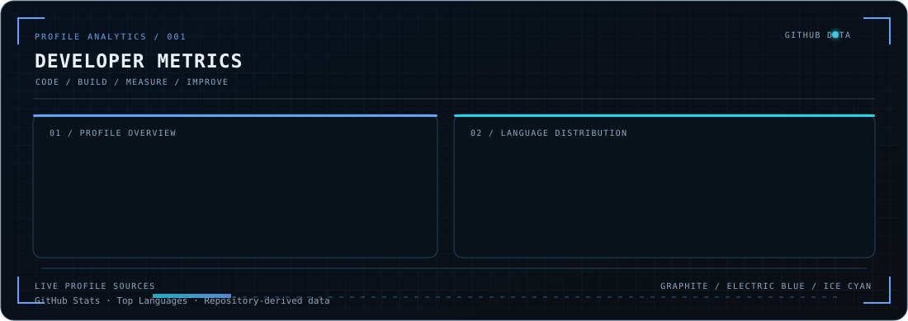

 

  

---

<table>
<tr>
<td width="58%" valign="top">

### `PROFILE / 001`

I'm **Akhil Saji**, a Full-Stack MERN Developer focused on building responsive web applications, practical user experiences, and maintainable application logic.

I work across the application stack: from React interfaces and API integration to Express services and MongoDB persistence.

- **Frontend:** responsive interfaces and reusable components
- **Backend:** REST API development and server-side logic
- **Data:** MongoDB, Mongoose, and CRUD workflows
- **Workflow:** Git, GitHub, debugging, and iterative development

</td>
<td width="42%" valign="top">

</td>
</tr>
</table>

## `03 / SYSTEM MODEL`

**Typical request path**

`Browser / React UI` → `HTTP request` → `Express route` → `Node.js logic` → `MongoDB` → `JSON response` → `React state / UI`

This is a reference architecture for MERN-style applications, not a claim that every project currently implements every layer.

---

<!-- ====================================================== -->
<!-- 01 / DEVELOPER METRICS                                 -->
<!-- ====================================================== -->

<h3 align="center">
  <code>01 / DEVELOPER METRICS</code>
</h3>

  

<!-- ====================================================== -->

<!-- ═══════════════ 02 / CONTRIBUTION STREAK ═══════════════ -->

<h2 align="center">
  <code>02 /</code> CONTRIBUTION STREAK
</h2>

  BUILD / CONTRIBUTE / LEARN / REPEAT

  

 

  

  

    CONSISTENT EFFORT CREATES EXTRAORDINARY RESULTS.
  

  
<b>KEEP BUILDING →</b>

## `07 / CONTACT`

  

**BUILD / DEBUG / SHIP / REPEAT**

Designed as a compact engineering portfolio · Akhil Saji

