 

  

---

<table>
<tr>
<td width="58%" valign="top">

### `PROFILE `

I'm **Akhil Saji**, a Full-Stack MERN Developer focused on building responsive web applications, practical user experiences, and maintainable application logic.

I work across the application stack: from React interfaces and API integration to Express services and MongoDB persistence.

- **Frontend:** responsive interfaces and reusable components
- **Backend:** REST API development and server-side logic
- **Data:** MongoDB, Mongoose, and CRUD workflows
- **Workflow:** Git, GitHub, debugging, and iterative development

</td>
<td width="42%" valign="top">

</td>
</tr>
</table>

## ` SYSTEM MODEL`

**Typical request path**

`Browser / React UI` → `HTTP request` → `Express route` → `Node.js logic` → `MongoDB` → `JSON response` → `React state / UI`

This is a reference architecture for MERN-style applications, not a claim that every project currently implements every layer.

---
<!-- ═══════════════════════════════════════════════════════ -->
<!-- 01 / DEVELOPER METRICS                                 -->
<!-- ═══════════════════════════════════════════════════════ -->

  <h2>
    DEVELOPER METRICS
  </h2>

  

    PROFILE ANALYTICS &nbsp; / &nbsp; CODE DISTRIBUTION &nbsp; / &nbsp; ACTIVITY
  

   
  <!-- PROFILE OVERVIEW -->
  <table>
    <tr>
      <td align="center">
        
      </td>
      <td align="center">
        
      </td>
    </tr>
  </table>

   
<!-- 02 / CONTRIBUTION STREAK -->
 <h2>
    CONTRIBUTION STREAK
  </h2>

  

## `CONTACT`

  

**BUILD / DEBUG / SHIP / REPEAT**

Designed as a compact engineering portfolio · Akhil Saji

